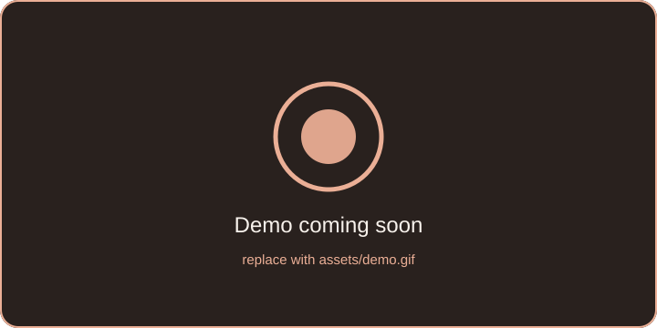
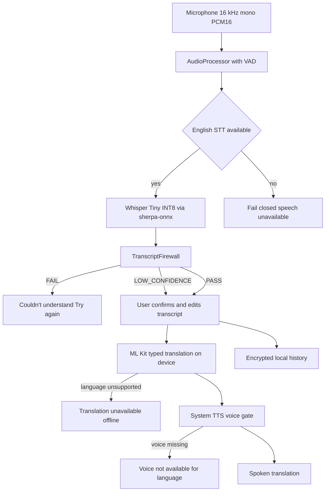
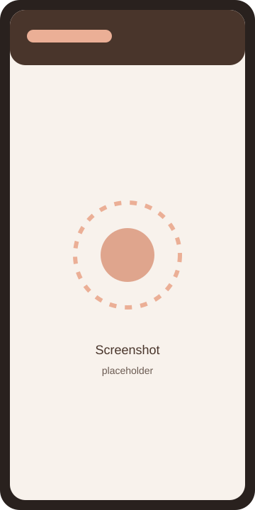

<div align="center">


<br />


<br />

[](https://github.com/mdanseergit/Whisly/releases/latest)
[](https://github.com/mdanseergit/Whisly/releases/latest)
[](https://github.com/mdanseergit/Whisly)
[](https://github.com/mdanseergit/Whisly/network/members)
[](./LICENSE)
[](https://github.com/mdanseergit/Whisly)
[](https://github.com/mdanseergit/Whisly/commits/main)
[](./CONTRIBUTING.md)

<br />

[](https://github.com/mdanseergit/Whisly/releases/latest)

**Windows · macOS · Android** — Whisly is an Android app. The APK is Android-only; Windows/macOS are supported as **build hosts** via the Gradle wrapper.

</div>

---

## 5. Demo

> **Demo placeholder.** The animated asset `assets/demo.gif` is not included yet.
> To record it: run the app on an arm64 device or emulator, capture a short screen
> recording of the microphone → transcript confirmation → translation → speech flow,
> trim it to ~10 seconds, and export as an optimised GIF into `assets/demo.gif`.
> Then replace the placeholder reference below with `assets/demo.gif`.

<div align="center">
  
</div>

---

## 6. About / Problem Statement

Whisly is an **Android application** for privacy-first, on-device speech and text translation between English and Indian languages. It targets two-person conversation: one person speaks, Whisly transcribes, asks for confirmation, translates, and speaks the result.

The problem it addresses: most speech-translation tools send audio to a cloud service, which costs money, needs connectivity, and exposes private conversations. Whisly keeps the speech recognition, translation, and synthesis on the device and **fails closed** when a stage cannot be trusted — it never substitutes a guessed or canned answer.

Current measured scope (see [`whisly/docs/MODELS.md`](./whisly/docs/MODELS.md) and [`whisly/docs/EVAL_RESULTS.md`](./whisly/docs/EVAL_RESULTS.md)): English speech-to-text is a **BETA** capability; the 12 Indic speech-to-text languages and speech auto-detect are **UNAVAILABLE**. Typed-text translation works for the nine languages with on-device ML Kit models. This is a preview, not a production release.

---

## 7. Key Features

- 🎙️ **On-device English STT (BETA)** — bundled multilingual Whisper Tiny INT8 running through sherpa-onnx; microphone capture at 16 kHz mono PCM16.
- 🛡️ **Fail-closed transcript firewall** — `PASS` / `LOW_CONFIDENCE` / `FAIL`; low-confidence results show **“Not sure: check and edit”**, undecodable audio shows **“Couldn't understand. Try again.”** No invented confidence scores.
- ✍️ **Mandatory transcript confirmation** — the user edits and confirms what was heard before translation runs.
- 🌐 **On-device typed translation** — ML Kit neural translation for `en, hi, bn, ta, te, kn, mr, gu, ur`; unsupported languages fail closed with a clear offline message.
- 🔊 **System TTS with a strict voice gate** — only installed, non-network voices with the exact locale and script are used; otherwise the app says the voice is unavailable.
- 🔐 **Encrypted local data** — translation history, saved phrases and settings stored with Room and AES-GCM via Android Keystore; raw microphone audio is not persisted.
- 🧭 **Single immutable pipeline state machine** — listening, transcribing, confirming, translating and speaking cannot overlap.
- 🧯 **Crash-loop Safe Mode and exit reports** — recovery path after repeated crashes, with a user-visible diagnostic report.
- 🎨 **Compose design system** — warm brown / peach palette, adaptive launcher icon, audio-reactive voice orb and animated navigation.

---

## 8. How It Works



The same state machine drives both single-speaker translation and the two-person conversation screen.

---

## 9. ML / AI Details

| Stage | Component | Status | Measured evidence |
|---|---|---|---|
| Speech-to-text | OpenAI Whisper Tiny, multilingual, INT8 encoder + decoder (103,609,903 B bundled) via sherpa-onnx 1.13.5 | **BETA for `en`**, **UNAVAILABLE for 12 Indic languages** | FLEURS `en_us` 10 clips: WER **0.2386**, CER **0.1021**; 1/10 garbage outputs on adversarial set (PC-side measurement, not on-device) |
| Confidence | `TranscriptFirewall` | Fail-closed | No per-token log-probs in current model → every result is `LOW_CONFIDENCE` and requires confirmation |
| Typed translation | Google ML Kit on-device translator | Available for `en, hi, bn, ta, te, kn, mr, gu, ur` | One-time model download required; no API key |
| Text-to-speech | Android `TextToSpeech` system voices | Available where an installed offline voice matches locale + script | No bundled neural voice; strict installed/non-network/script gate |
| Speech auto-detect | — | **UNAVAILABLE** | Path removed; the user selects the source language |
| Training / fine-tuning | — | None in this repo | No training code, no fine-tuning, no paid compute |

**Models and datasets.** The only bundled model is the non-gated official `sherpa-onnx-whisper-tiny` INT8 export (weights MIT, export tooling Apache-2.0). Evaluation used FLEURS `en_us` (10 clips), CC0 noise (20 clips), and Hindi Kathbath/adversarial manifests — all evaluation-only. `base.en` and `small.en` were measured as candidates but are **not bundled**. Details, hashes, source URLs and licenses are in [`whisly/docs/EVAL_RESULTS.md`](./whisly/docs/EVAL_RESULTS.md) and [`whisly/docs/MODELS.md`](./whisly/docs/MODELS.md).

**Limitations.** No real-phone runtime measurement, no native-speaker or TTS quality review, no Play Console compressed-size measurement, no offline clean-install proof. The release APK is **debug-signed** and its post-R8 runtime behaviour is **UNMEASURED**. Not production-ready.

---

## 10. Screenshots

> Placeholders only — real screenshots must be added to `assets/screenshots/` before publishing.

| Screen | Preview | What to capture |
|---|---|---|
| Translate |  | Mic idle → listening → confirmed transcript → translated card |
| Conversation |  | Two-person mode with source and target language selectors |
| Text translation |  | Typed input and translated output |
| Languages / downloads |  | Language matrix showing BETA / UNAVAILABLE tiers and model packs |

---

## 11. Tech Stack

<p align="center">
  
</p>

Kotlin 2.2.10 · Android Gradle Plugin 9.1.1 · Gradle 9.3.1 · Jetpack Compose · Navigation · Room + KSP · Coroutines · Moshi / Retrofit / OkHttp · ML Kit Translate · sherpa-onnx 1.13.5 · optional FastAPI control plane under `whisly/backend/`.

---

## 12. Installation

### (a) Download from Releases

1. Open the [latest release](https://github.com/mdanseergit/Whisly/releases/latest).
2. Download `Whisly-v1.0.0.apk` (arm64-v8a, Android 7.0 / API 24 or newer).
3. On the phone, allow installation of apps from unknown sources for your browser or file manager, then open the APK.

> The published APK is a **debug-signed preview**. It is not a Play Store build and should not be treated as a production release.

### (b) Run from source

```bash
git clone https://github.com/mdanseergit/Whisly.git
cd Whisly/whisly
./gradlew clean assembleDebug testDebugUnitTest lint
```

Requirements: JDK 17+, Android SDK with API 36 and build-tools installed, and a `local.properties` file pointing `sdk.dir` at your Android SDK. The Gradle wrapper downloads the correct Gradle version. See [`docs/ENVIRONMENT.md`](./docs/ENVIRONMENT.md).

Install the resulting debug APK from `whisly/app/build/outputs/apk/debug/` on an arm64-v8a device or emulator.

Optional control-plane API (not used by the app at runtime):

```bash
cd Whisly/whisly/backend
python -m venv .venv && . .venv/bin/activate   # Windows: .venv\Scripts\activate
pip install -r requirements.txt
uvicorn app.main:app --reload
```

---

## 13. Usage

- **Single translation:** open **Translate**, choose source and target languages, tap the microphone, edit the transcript in the confirmation step, then confirm. Translation and system speech playback follow.
- **Conversation:** open **Conversation** and use the same flow with two language selectors.
- **Typed input:** open **Text translation** to translate typed text without using the microphone.
- **Languages:** open **Languages** to see measured stage tiers and install required on-device packs.
- **Build and verify locally:**

```bash
cd whisly
./gradlew.bat clean assembleDebug testDebugUnitTest lint
./gradlew.bat assembleRelease bundleRelease
```

Recorded results: 47 unit/Robolectric tests passed, 0 lint errors (105 warnings). Full evidence is in [`whisly/deliverables/FINAL_APK/BUILD_LOG.txt`](./whisly/deliverables/FINAL_APK/BUILD_LOG.txt).

---

## 14. Project Structure

```text
Whisly/
├── README.md, LICENSE, CONTRIBUTING.md
├── assets/
│   ├── demo-placeholder.svg          # replace with demo.gif
│   └── screenshots/                  # add real screenshots here
├── docs/
│   ├── ENVIRONMENT.md
│   └── RELEASE_NOTES.md
└── whisly/
    ├── app/src/main/java/com/example/
    │   ├── MainActivity.kt            # Compose entry point
    │   ├── ai/audio/                  # AudioProcessor, VAD
    │   ├── ai/pipeline/               # PipelineOrchestrator state machine
    │   ├── ai/registry/               # CapabilityRegistry (source of truth)
    │   ├── ai/stt/                    # sherpa-onnx Whisper engine, TranscriptFirewall
    │   ├── ai/translation/            # ML Kit typed translation
    │   ├── ai/tts/                    # system TTS voice gate
    │   ├── core/                      # navigation, security, config
    │   ├── data/                      # Room entities, DAO, repositories
    │   └── presentation/              # Compose screens + ViewModel
    ├── app/src/main/assets/whisper/tiny/   # bundled INT8 STT model
    ├── backend/                       # optional FastAPI control plane
    ├── docs/                          # measured evaluation and diagnosis reports
    ├── deliverables/FINAL_APK/        # final APK, mapping, build log, hashes
    └── scripts/                       # evaluation harness helpers
```

---

## 15. Roadmap

- [x] On-device English STT beta with bundled Whisper Tiny INT8
- [x] Fail-closed transcript firewall and mandatory confirmation
- [x] On-device typed translation for nine language tags
- [x] Strict system-TTS voice gate
- [x] Encrypted local history and Safe Mode
- [x] Clean build: tests and lint verified
- [ ] Indic speech-to-text via separately approved model packs
- [ ] Speech language auto-detect
- [ ] Bundled neural text-to-speech
- [ ] Real upload key and Play App Signing
- [ ] On-device / real-phone runtime measurements and native-speaker review
- [ ] Screenshots and a real demo GIF

---

## 16. Contributing, License, Contact

Contributions are welcome — see [`CONTRIBUTING.md`](./CONTRIBUTING.md). Please open an issue before adding a model, a language, or a cloud dependency: capabilities in Whisly are evidence-gated.

**License:** MIT — see [`LICENSE`](./LICENSE). Third-party model and library licenses are listed in [`whisly/docs/MODELS.md`](./whisly/docs/MODELS.md) and [`whisly/NOTICE`](./whisly/NOTICE).

**GitHub:** [@mdanseergit](https://github.com/mdanseergit) · **LinkedIn:** _to be added_ · **Email:** _to be added_

---

<div align="center">


<br />

### ⭐ Star this repo if Whisly was useful to you.

Made for private, on-device conversation.

</div>
