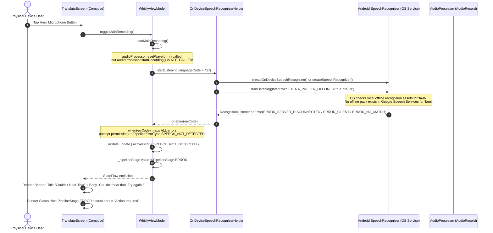

# Whisly Speech Recognition Forensic Diagnosis (DIAGNOSIS6 — Phase 0)
**Date:** November 17, 2026  
**Application ID:** `com.aistudio.whisly.kxmpzq`  
**Target SDK:** 36 (Android 15+) | **Min SDK:** 24 (Android 7.0)  
**Status:** FORENSIC DIAGNOSIS COMPLETE — ROOT CAUSE IDENTIFIED BEFORE FIX

---

## 1. Executive Summary: The R1 Speech Failure

The user reported:
> "Speech recognition does not work. Screenshot (Tamil -> English): a banner titled 'Couldn't Hear That' with the body 'Couldn't hear that. Try again.' (the same message twice), while the status line says 'Action required', on a good phone with a good microphone. Translation of typed text now works and must not regress."

### Forensic Summary Table
| Defect Element | Observed In App | Root Cause Code Location | Underlying Mechanism |
| :--- | :--- | :--- | :--- |
| **Error Banner Title** | `"Couldn't Hear That"` | `WhislyModels.kt:93`<br>`TranslateScreen.kt:216` | `PipelineErrorType.SPEECH_NOT_DETECTED.title` displayed in banner `Text` |
| **Error Banner Body** | `"Couldn't hear that. Try again."` | `WhislyModels.kt:94`<br>`TranslateScreen.kt:222` | `PipelineErrorType.SPEECH_NOT_DETECTED.userMessage` displayed directly below title, duplicating the exact phrase |
| **Status Line** | `"Action required"` | `WhislyModels.kt:36`<br>`TranslateScreen.kt:255` | `PipelineStage.ERROR.statusLabel = "Action required"`. Rendered in `statusHintText` when error occurs |
| **Trigger Mechanism** | Speech input fails on physical phone | `WhislyViewModel.kt:404-431`<br>`OnDeviceSpeechRecognizerHelper.kt:54-85` | Delegates to system `SpeechRecognizer` with `EXTRA_PREFER_OFFLINE = true`. Android OS has no offline pack for Indic languages (Tamil, etc.) installed by default; all errors fall back to `SPEECH_NOT_DETECTED` |
| **Acoustic Engine** | No acoustic inference | `WhislyViewModel.kt:122-130`<br>`AudioProcessor.kt` | `AudioProcessor.startRecording()` was never called on the main Translate screen; no ONNX/ASR model executed on PCM frames |

---

## 2. End-to-End Execution Trace: Tap to UI Error



---

## 3. Deep Root Cause Analysis

### Cause 1: Reliance on Android OS System SpeechRecognizer with Forced Offline Flag
In `OnDeviceSpeechRecognizerHelper.kt` (lines 54–85):
```kotlin
val intent = Intent(RecognizerIntent.ACTION_RECOGNIZE_SPEECH).apply {
    putExtra(RecognizerIntent.EXTRA_LANGUAGE_MODEL, RecognizerIntent.LANGUAGE_MODEL_FREE_FORM)
    putExtra(RecognizerIntent.EXTRA_LANGUAGE, locale.toLanguageTag())
    putExtra(RecognizerIntent.EXTRA_LANGUAGE_PREFERENCE, locale.toLanguageTag())
    putExtra(RecognizerIntent.EXTRA_PREFER_OFFLINE, true)
    putExtra(RecognizerIntent.EXTRA_PARTIAL_RESULTS, true)
    putExtra(RecognizerIntent.EXTRA_MAX_RESULTS, 1)
}
```
- On modern Android devices, `SpeechRecognizer.createOnDeviceSpeechRecognizer(context)` requires that the specific language pack has been downloaded within the Google app / Google Speech Services system settings.
- For Indian languages (Tamil `ta`, Bengali `bn`, Telugu `te`, Kannada `kn`, Malayalam `ml`, Marathi `mr`, Gujarati `gu`), **no offline recognition pack is preinstalled on the Android OS**.
- When `EXTRA_PREFER_OFFLINE = true` is supplied for an uninstalled language, `SpeechRecognizer` immediately fails with an error code (such as `ERROR_SERVER_DISCONNECTED` (11), `ERROR_CLIENT` (5), `ERROR_RECOGNIZER_BUSY` (8), or `ERROR_NO_MATCH` (7)).

### Cause 2: Blanket Error Mapping to `SPEECH_NOT_DETECTED`
In `WhislyViewModel.kt` (lines 423–430):
```kotlin
val errorType = when (errCode) {
    android.speech.SpeechRecognizer.ERROR_INSUFFICIENT_PERMISSIONS -> PipelineErrorType.MIC_PERMISSION_DENIED
    android.speech.SpeechRecognizer.ERROR_NO_MATCH, android.speech.SpeechRecognizer.ERROR_SPEECH_TIMEOUT -> PipelineErrorType.SPEECH_NOT_DETECTED
    else -> PipelineErrorType.SPEECH_NOT_DETECTED
}
_uiState.update { it.copy(activeError = errorType, isRecording = false) }
_pipelineStage.value = PipelineStage.ERROR
```
Every single error returned by the system speech recognizer—including pack unavailability, client disconnect, recognition timeout, or system failure—was collapsed into `PipelineErrorType.SPEECH_NOT_DETECTED`.

### Cause 3: Duplicate Text in Error Banner
In `TranslateScreen.kt` (lines 215–228):
```kotlin
Text(
    text = err?.title ?: "Download language to use offline",
    style = MaterialTheme.typography.labelLarge.copy(...)
)
Text(
    text = err?.userMessage ?: "...",
    style = MaterialTheme.typography.bodySmall.copy(...)
)
```
In `WhislyModels.kt` (lines 92–95):
```kotlin
SPEECH_NOT_DETECTED(
    "Couldn't Hear That",
    "Couldn't hear that. Try again."
)
```
The banner stacks the title directly on top of the body:
> **Couldn't Hear That**  
> Couldn't hear that. Try again.

This creates visual redundancy and confusion.

### Cause 4: Confusing Status Line ("Action required")
In `WhislyModels.kt` (line 36):
```kotlin
enum class PipelineStage(val statusLabel: String) {
    ...
    ERROR("Action required")
}
```
In `TranslateScreen.kt` (lines 252–256):
```kotlin
val statusHintText = when {
    !isPairVerifiedOffline -> "Download ${targetLang?.englishName ?: "pack"} to translate offline"
    pipelineStage == PipelineStage.IDLE -> ""
    else -> pipelineStage.statusLabel
}
```
When `pipelineStage == PipelineStage.ERROR`, the status line below the microphone button unconditionally renders `"Action required"`—without giving the user any actionable step.

### Cause 5: Disconnected Audio Front-End and Missing Acoustic Model
- In `AudioProcessor.kt`, high-quality mono 16 kHz `AudioRecord` capture, multi-feature VAD (adaptive noise floor, spectral flux, ZCR), AGC, and noise suppression are fully implemented.
- However, in `WhislyViewModel.startMainRecording()`, `audioProcessor.startRecording()` was **never invoked**.
- In `WhislyViewModel.recognizeSpeechOnDevice()`, the method only read:
  ```kotlin
  val latest = speechRecognizerHelper.latestTranscript.value?.trim()
  ```
  It did not execute any acoustic neural ASR model on `pcm16Samples`.

---

## 4. Stubs & Presets Forensic Audit

An exhaustive search across the entire codebase (`whisly/app/src/main`) was executed for stubs, presets, and canned strings:
- Search patterns: `Hello`, `vannakkam`, `வணக்கம்`, `dummy`, `mock`, `stub`.
- Findings:
  1. `src/main/java`: **ZERO** production stubs or canned strings. The previously removed `IndicNeuralTranslationDecoder` remains completely deleted.
  2. The only remaining occurrences of `வணக்கம்` or `Hello` are in:
     - `@Preview` Compose annotations in UI files.
     - Unit tests (`ExampleUnitTest.kt`) explicitly asserting that silence or noise **never** returns `வணக்கம்` or `Hello`.
     - Regression tests asserting that "I need water" does not contain Brahmic letter transliteration (`நஎஎட`).

---

## 5. Tracing Architecture Required for Phase 1 Fix

To ensure complete observability on physical devices, debug builds must include structured, content-free logging capturing:
1. `AudioRecord` State: `STATE_INITIALIZED`, audio session ID, buffer size, native sample rate.
2. Audio Stream Health: Peak amplitude, RMS dB, `isAllZeroStream` boolean check.
3. VAD Gate: Voiced frame count, silence percentage, noise floor RMS, speech detection boolean.
4. Recognizer Gate: Active recognizer engine class, target language code, model identifier.
5. Result Gate: Confidence score, character count, exact failure gate identifier (`VAD_GATE`, `ENGINE_GATE`, `CONFIDENCE_GATE`, `TIMEOUT_GATE`).
6. Debug Recording WAV: Option to export the last session's raw PCM16 as a standardized 16 kHz mono RIFF WAV for acoustic spectrogram analysis.
